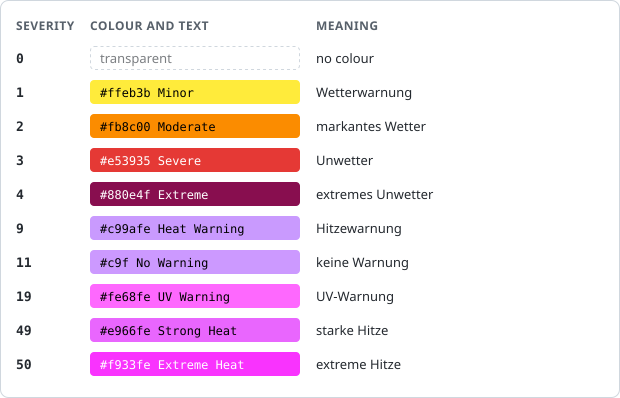
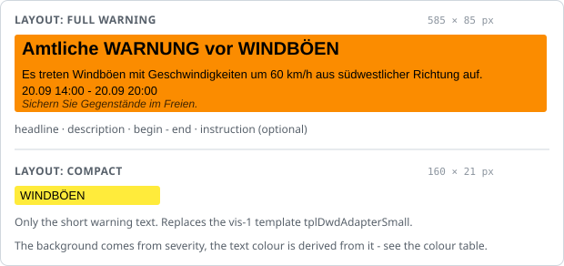
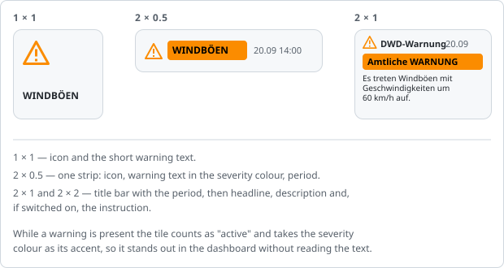
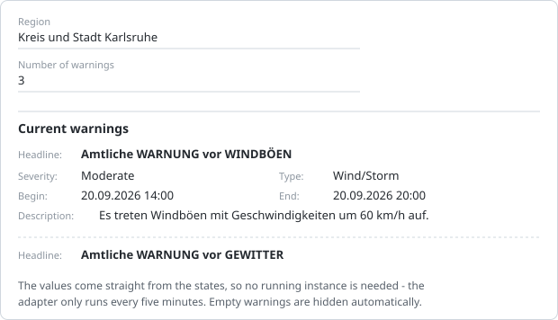

# DWD widgets

The `dwd` adapter ships two front-ends besides the adapter itself:

| Where                | What                                               |
|----------------------|----------------------------------------------------|
| **vis / vis-2**      | the `DWD warnings` widget, in the widget set `dwd` |
| **ioBroker.devices** | the `DWD warning` tile for the dashboard           |

Both show the same data and are configured the same way: pick the adapter instance and the number of
the warning. Everything else is optional.

The instance settings show the warnings that are currently active as well, see
[The instance settings](#the-instance-settings).

---

## The warnings of the adapter

The adapter writes the warnings of the configured region into numbered channels:

```
dwd.0.warning0.headline      Amtliche WARNUNG vor WINDBÖEN
dwd.0.warning0.text          WINDBÖEN
dwd.0.warning0.description   Es treten Windböen mit Geschwindigkeiten ...
dwd.0.warning0.instruction   recommendation of the DWD, often empty
dwd.0.warning0.severity      0, 1 … 4, 9, 11, 19, 49, 50
dwd.0.warning0.begin         start, milliseconds since epoch
dwd.0.warning0.end           end, may be empty
dwd.0.numberOfWarnings       how many warnings are currently active
```

**`warning0` is always the most severe warning that is currently active.** The list is re-sorted on
every run, so a widget pointed at `warning0` always shows the most important one — it does not stay
on one particular event. How many `warning<n>` channels exist is set in the adapter configuration
("Number of warnings", 1 … 10).

When there are fewer warnings than channels, the remaining channels are emptied. The widgets then
show "No warning".

### The colour

The background colour comes from `severity` and is the same in both widgets and in the old vis-1
widget set:

| severity | meaning | colour |
| --- | --- | --- |
| 0 | none | — |
| 1 | weather warning | `#ffeb3b` |
| 2 | warning of significant weather | `#fb8c00` |
| 3 | severe weather warning | `#e53935` |
| 4 | warning of extreme severe weather | `#880e4f` |
| 9 | heat warning | `#c99afe` |
| 11 | no warning | `#c9f` |
| 19 | UV warning | `#fe68fe` |
| 49 | strong heat | `#e966fe` |
| 50 | extreme heat | `#f933fe` |



*Rendered, with the text colour each background gets.*

These colours carry the meaning of the warning, so they do **not** follow the light/dark theme —
`#880e4f` stays `#880e4f` in both. Only the text colour on top of them is chosen automatically
(black or white), so the text stays readable in either theme.

---

## vis-2: the `DWD warnings` widget

Widget set `dwd`, widget `DWD warnings`.



### Settings

| Setting | Meaning |
| --- | --- |
| **Layout** | `Full warning` — headline, description, period and instruction. `Compact` — one line with the short warning text. |
| **Instance** | which `dwd` instance to read |
| **Warning** | number of the `warning<n>` channel. `0` is the most severe one. |
| **Time format** | how begin and end are printed. Placeholders: `YYYY`, `YY`, `MM`, `DD`, `hh`, `mm`, `ss`. Default `DD.MM hh:mm`. Only in the full layout. |
| **Show instruction** | shows `instruction` — the recommendation of the DWD. It is often empty. Only in the full layout. |
| **Without card** / **Name** | the usual vis-2 card around the widget |

Under **Object IDs** there is one more switch:

| Setting | Meaning |
| --- | --- |
| **Set object IDs manually** | Turns off the derivation from instance and warning number and lets you point the widget at any six states. Only needed if the states do not come from a `dwd` instance. |

### Coming from vis-1

The old widget set had two templates, `tplDwdAdapter` (large) and `tplDwdAdapterSmall` (compact).
The vis-2 widget is **one** widget and the two variants are the `Layout` setting.

- Views that use **`tplDwdAdapter`** are taken over by the vis-2 widget automatically — it registers
  under the same template id. The object ids that are already configured keep being used, so the
  widget shows what it showed before. Nothing has to be changed by hand.
- Views that use **`tplDwdAdapterSmall`** keep running with the old vis-1 template, which is still
  shipped. To move them to the vis-2 widget, place a `DWD warnings` widget and set `Layout` to
  `Compact`.

> **Note on the old default value:** in the vis-1 widget the field for the instruction was
> pre-filled with `dwd.0.warning.hint`. That state does not exist — the adapter writes
> `dwd.0.warning.instruction`. If your instruction stayed empty, that was why. The vis-2 widget uses
> the correct state when it derives the ids itself.

---

## ioBroker.devices: the `DWD warning` tile

In the dashboard of `ioBroker.devices`, add the widget **DWD warning**.



### Settings

| Setting | Meaning |
| --- | --- |
| **Instance** | which `dwd` instance to read |
| **Warning** | number of the `warning<n>` channel. `0` is the most severe one. |
| **Time format** | how begin and end are printed, same placeholders as above |
| **Show period** | shows begin and end of the warning |
| **Show instruction** | shows the recommendation of the DWD, off by default |
| **Icon** / **Name** | the usual tile header |

### The three sizes

The tile adapts to the size it gets in the dashboard:

- **1×1** — icon and the short warning text.
- **2×0.5** — one strip: icon, warning text in the severity colour, period.
- **2×1 and 2×2** — the title bar with the period, then headline, description and, if switched on,
  the instruction.

The tile is marked as "active" while a warning is present, and takes the severity colour as its
accent — so an active warning is visible in the dashboard without reading the text.

---

## The instance settings

Below the configuration, the instance settings list the warnings that are currently active for the
configured region:



The values are read straight from the states, **not** from the adapter process — the adapter runs in
schedule mode and is only alive for a few seconds every five minutes, so anything that had to ask the
running instance would usually time out.

A warning whose headline is empty is hidden, and so are the `warning<n>` channels that do not exist
because "Number of warnings" is set lower. If there is no warning at all, a single line says so. The
list updates by itself when the adapter writes new values — the dialog does not have to be reopened.

---

## Building from source

```bash
npm run build            # adapter + both front-ends
npm run build:widgets    # only the vis-2 widget set -> widgets/dwd/
npm run build:devices    # only the devices tile     -> admin/dm-widgets/
```

The sources are in `src-widgets/` (vis-2) and `src-devices/` (devices dashboard). Both are React +
TypeScript, built with vite and module federation. The component names and the URL are repeated in
`io-package.json` under `common.visWidgets` and `common.deviceWidgets` — adding a widget means
touching the `exposes` of the vite config **and** that block.
